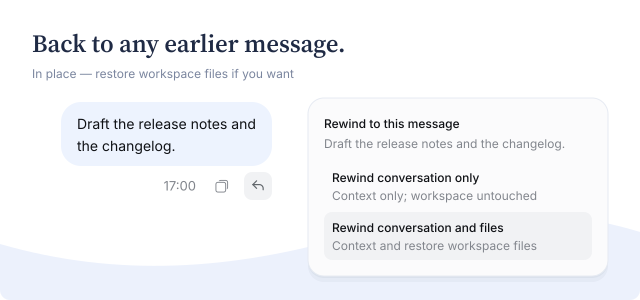
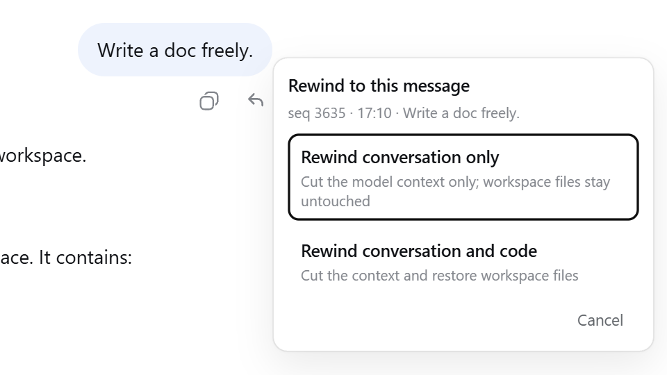
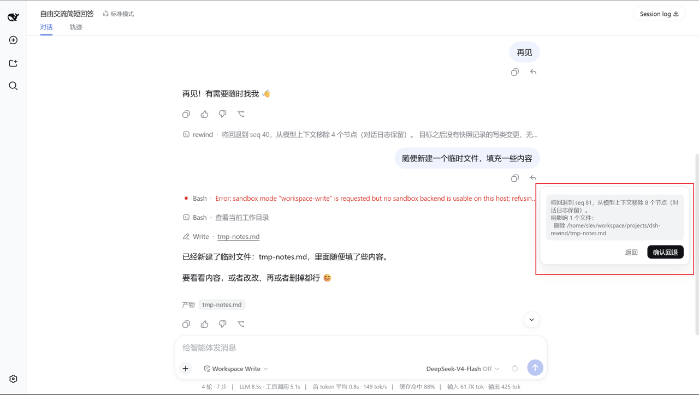
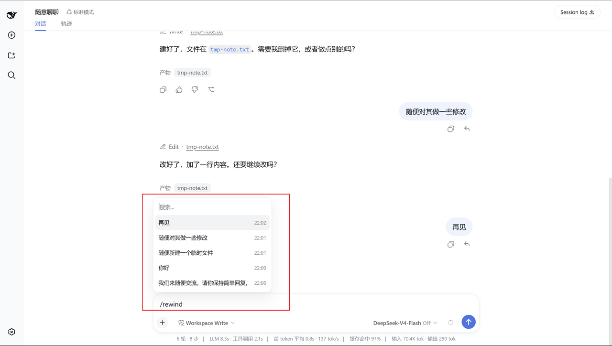
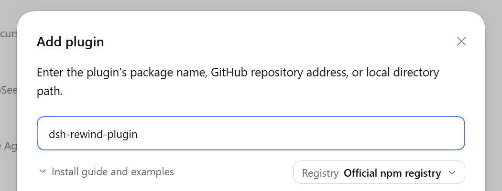

# dsh-rewind

DeepSeek Harness plugin: **in-window conversation rewind to any earlier user message**.<br />No forking, no window switch, with optional workspace-file restore — Claude Code-style `/rewind` semantics.

English | [中文](README.zh.md)

[](https://www.npmjs.com/package/dsh-rewind-plugin)
[](https://www.npmjs.com/package/dsh-rewind-plugin)
[](https://github.com/SiriLee/dsh-rewind/actions/workflows/ci.yml)



A deliberately focused plugin with one job: **rewind to any user message, no matter how far back, in place** — and conveniently **restore the files it changed** along the way.

- **In-place rewind, no new session** — the target message and everything after it are withdrawn from the model context *and* the rendered transcript, and the target's prompt is restored into the input field so you can re-send or edit it. It all happens inside the original session: no new branch, no leftover copy.
- **Conversation and files rewind together** — Claude Code-aligned behavior: automatically tracks DSH's file edits as you work, allowing you to quickly undo changes and rewind to previous states if anything gets off track.
- **Safety guarantees** — the session log only ever appends rewind markers and is never deleted or rewritten; file backup and restore are hardened; tests are comprehensive, and maintenance continues across DSH upgrades. Security model: [docs/security-model.md](docs/security-model.md).

## Preview

Every user message carries a **↶ rewind** button in its action row. Clicking it opens a mode-selection popover — "**rewind conversation only**" or "**rewind conversation and files**", the latter showing the file-change list for confirmation first. You can also pick and rewind conveniently via the **`/rewind` and `/undo` commands**.

<table>
  <tr>
    <td align="center"><br><sub>Per-message ↶ rewind button</sub></td>
    <td align="center"><br><sub>Mode-selection popover</sub></td>
  </tr>
  <tr>
    <td align="center"><br><sub>"Conversation and files" impact list</sub></td>
    <td align="center"><br><sub>/rewind candidate picker</sub></td>
  </tr>
</table>

## Install

**Command line**:

```sh
dsh plugin --profile <name> add dsh-rewind-plugin
```

**Graphical interface**: the **Plugins** page → **Add plugin** → enter `dsh-rewind-plugin` → install.

<br>

The default install is built for the latest stable DSH release. If you are on a different DSH version, find a matching one in [Releases](https://github.com/SiriLee/dsh-rewind/releases).

> [!WARNING]
> The npm name `dsh-rewind` belongs to another author's package — install with `dsh-rewind-plugin`.

## Usage

1. Find the user message you want to rewind to in the conversation, or type `/rewind` (or its alias `/undo`) to open the rewind menu.
2. **Select it.** A small popover offers the two modes — "conversation only" or "conversation and files".
3. After restoring the conversation, the original prompt from the selected message is restored into the input field so you can re-send or edit it.

**Keyboard**: both the candidate picker and the mode popover support ↑↓ to move, Enter to confirm, Esc to cancel/back.

<details>
<summary><b>Edge notes</b></summary>

- **The withdrawn content is preserved** — it stays in the session log and can be inspected in the **Trajectory** panel; you can also disable the plugin to show it again (display only).
- **A rewind cannot be undone in place** — to carry the content forward, first disable the plugin so the withdrawn content shows again, then click **Branch into a new conversation** on the message just before the rewind; the new conversation's context will include it.
- **Interruptions rewind too** — a `steering` message the model hasn't read yet is also a valid rewind target, and withdrawing it does not interrupt the current run.
- **Rewinding a read message interrupts the running turn** — to ensure the rewind runs safely.

</details>

## Snapshot management

As you work with dsh-rewind, checkpointing automatically captures the state of your code before each prompt you send that starts a turn. This creates the session's **snapshots** and saves them to `<dsh home>/rewind-snapshots/` (default: `~/.dsh/rewind-snapshots/`). The plugin keeps file snapshots for the 100 most recent checkpoints in a session. Discarding an older checkpoint deletes the snapshot files that no remaining checkpoint references.

The **Snapshot backups** feature (on by default) controls checkpointing. It can be switched off in this plugin's configuration card. When off, no new snapshots are created; file changes made while off cannot be restored. Users who do not need file restore can avoid the extra copies and read/write overhead.

The **Snapshot auto-cleanup** feature (off by default) deletes the snapshot directories of long-inactive sessions when enabled, once the session has been idle for about 30 days (by default). Configure and review it in this plugin's configuration card (the auto-cleanup switch and the idle-day cutoff). See [Snapshot auto-cleanup](docs/snapshot-auto-cleanup.md) for details.


## Uninstall

```sh
# Uninstall the plugin
dsh plugin --profile <name> remove dsh-rewind-plugin

# To also delete local data
rm -rf <dsh home>/rewind-snapshots
rm <dsh home>/snapshot-cleanup-last-sweep.json
```

The plugin's configuration entries are stored in the current Profile's config file `cordis.patch.yml`. To clean up completely, delete the corresponding entries manually.

## What this plugin changes

Compared with the default behavior:

| Dimension | Default behavior | This plugin |
| --- | --- | --- |
| Conversation rewind | Branch into a new conversation | **In-place rewind** — no new session branch, no window switch, no leftover session copies |
| File restore | Manual restore / Git management | **One-click restore** — quickly undo changes together with the conversation, fitting agent workflows |
| Restore dependencies | Often needs a Git repository or a full snapshot engine | **None** — works in any directory |

## How it works

The whole design rests on two principles, simple but deliberate: **the conversation half "masks, never deletes"**, using DSH's native "hide + replace" mechanism; **the file half "partial tracking + checkpointing"**, following Claude Code's checkpoint semantics.

### 1. Conversation rewind: a single "mask", not a delete

`append-only` is a hard rule: the session log only grows and is never rewritten — the foundation of auditability and privacy. A rewind never touches history; it makes a single move: append **one "empty message" marker** to the end of the log and use it to "mask + replace" the target message and everything after it, so the model and the UI see only what came before it.

- **One and the same log** — the append happens only in the current session's log: no new session, no new branch, so no residue or copy is left behind;
- **The marker is canonical** — the same "hide + replace" as the official `/compact`: `/compact` compresses a span of history into a summary, while `/rewind` swaps in an "empty message" marker. Because it is canonical, DSH's log replay, compaction, and resume preflight all recognize it and never mistake it for a real message;
- **The replacement is imperceptible** — the model ignores the marker, with no effect (verified empirically). Together with the plugin's UI handling, what you and the model see is exactly how the conversation looked at the target;
- **Content is preserved** — because this is "masking, not deleting", the withdrawn content stays in the log — auditable, traceable, and in principle manually recoverable.

> **Design note**: the entire conversation rewind is **a single append**. It's deterministic, auditable, and — because the log was never broken — a "clean" time-travel. Minimal action, complete semantics.

### 2. File restore: partial tracking and lightweight checkpointing

The file half follows Claude Code's checkpoint semantics — **partial tracking + checkpointing**, not a whole-tree snapshot. This trade-off saves space while still covering changes to tracked files:

- **Partial tracking**: tracks all changes made by DSH's file editing tools (`write`, `edit`) — records the files it first touches and backs up their pre-edit status; it never backs up the whole workspace, so it's lightweight.
- **Checkpointing**: automatically captures the state of your **tracked files** before each prompt you send that starts a turn. External changes to tracked files such as a command run or a manual edit can be restored by a later rewind.
- **Unchanged-not-stored**: when checkpointing, an unchanged file is never backed up; the same version from the previous checkpoint is reused instead of a copy.
- **Accurate restore**: backups are the sole standard, checked against the real disk — **only files that actually differ are touched**. Backups are stored byte for byte, so the restored result matches the backups exactly, with no "ghost impact". Coverage is bounded by design: [File-rewind tracking boundary](docs/compat/tracking-boundary.md).
- **Safety and integrity**: paths are sanitized so nothing ever escapes the backup root; symlinks / hard links are skipped so one restore can't clobber another name of the same file; a per-file failure never aborts the pass; checkpoints and versions are written atomically and kept across restarts, so a target file is never half-written; a crash can be rerun to converge.

> **Design note**: **boundary checkpointing + first-touch capture + version reuse** — the message-boundary checkpoint re-reads every tracked file and records its state; first touch adds a new file with its pre-touch state; restore touches only files that differ. Small on disk and suitable for quick, session-level recoveries.

## Scope and division of labour

This plugin deliberately stays lightweight and focused on one thing — "conversation rewind". The following are **out of its scope**, and each has a better owner (see [design boundaries](docs/boundaries.md)):

- **Whole-tree snapshots** — checkpoints are for quick, session-level recovery, not a replacement for version control. For permanent version history and collaboration, continue using version control, such as Git, for commits, branches, and long-term history.
- **Subagent edits** — not tracked, and no rewind inside a subagent session: a subagent runs its own session, so its backups could never be restored by a rewind of the parent session, and none are kept for one.
- **Fork / branch rewind** — DSH already provides this ("branch in new chat"); no need to reinvent the wheel.

## Compatibility

- Node.js `>=24.9.0`.
- Supported DSH versions are declared by `package.json` `engines.dsh`.
- Compatibility definition, verification method, and version alignment: see [docs/compat/audit.md](docs/compat/audit.md).

> [!WARNING]
> This project and DeepSeek Harness are both in developer preview. Pin exact versions in reproducible environments and review the behavior notes above.

## Known limitations

1. **Turn navigation keeps rewound turns** — the right-side turn navigation keeps an "unloaded" tick for each rewound turn, and hovering previews the withdrawn content. Only a display difference; no functional impact.
2. **A far rewind may show a blank transcript** — when the target predates the loaded history, the conversation area goes blank; click **Load earlier** to page back until the history appears.

> [!NOTE]
> Browser diagnostics are available; see [Browser diagnostics](docs/compat/diagnostics.md).

## Security

This plugin only appends rewind-marker events to the session log; it never deletes or rewrites logged history. Workspace files are written only when you choose "conversation and files"; backups are stored under `<dsh home>/rewind-snapshots/`; restores draw only from those backups. It never touches your git repository, makes no network requests, and accesses no credentials. For sessions you've left inactive for a long time, a snapshot auto-cleanup (off by default) can remove their snapshot directory in whole, leaving the active session and the chat log untouched. Full security model: [docs/security-model.md](docs/security-model.md); to report a vulnerability, see [SECURITY.md](SECURITY.md).

## Development

```sh
npm install            # devDeps from the npm registry
npm run check          # one-shot full gate: typecheck + test + build + verify:host + pack --dry-run
npm run typecheck      # tsc on all three surfaces (host + client + client-test)
npm test               # vitest: all unit and compatibility suites
npm run build          # esbuild: lib/index.js (host ESM) + lib/client.js (loader closure) + .d.ts
node scripts/verify-host.mjs   # end-to-end verification of the built artifact
```

`prepack` runs the full build, so `npm pack` / `npm publish` always ship a complete `lib/`. Install from npm or a packed tarball — a git checkout has no built `lib/`.

Maintainers: the source layout and architecture are in [docs/architecture.md](docs/architecture.md); the harness interface reference is in [docs/harness-reference.md](docs/harness-reference.md).

Contributing guide: [CONTRIBUTING.md](CONTRIBUTING.md).

## Release

Releases go out through GitHub Actions Trusted Publishing (OIDC, no stored `NPM_TOKEN`): push a `v<version>` tag and CI publishes with Sigstore provenance.

```sh
npm version patch && git push origin <branch> --tags
```

One-time npm-side setup and the full workflow details: [docs/release/release.md](docs/release/release.md).

## License

[MIT](LICENSE)
