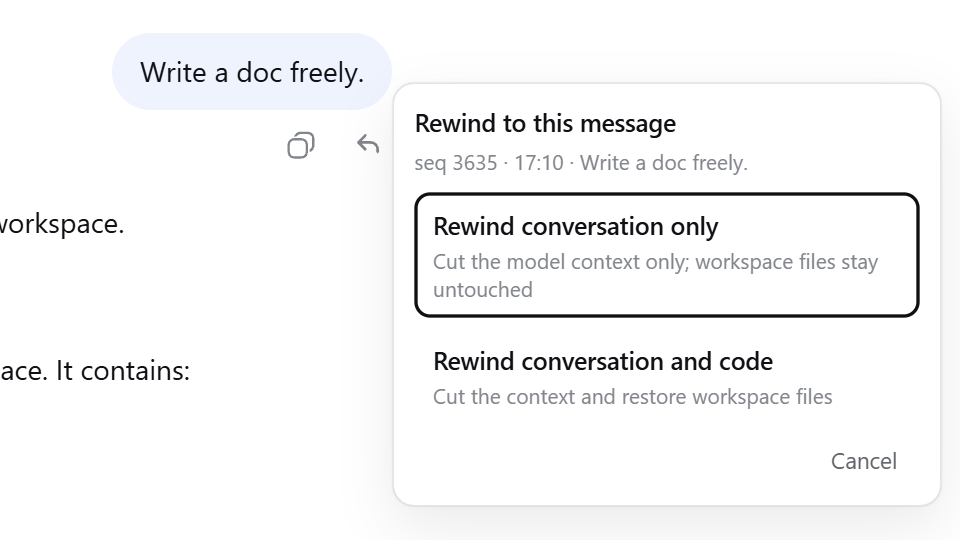
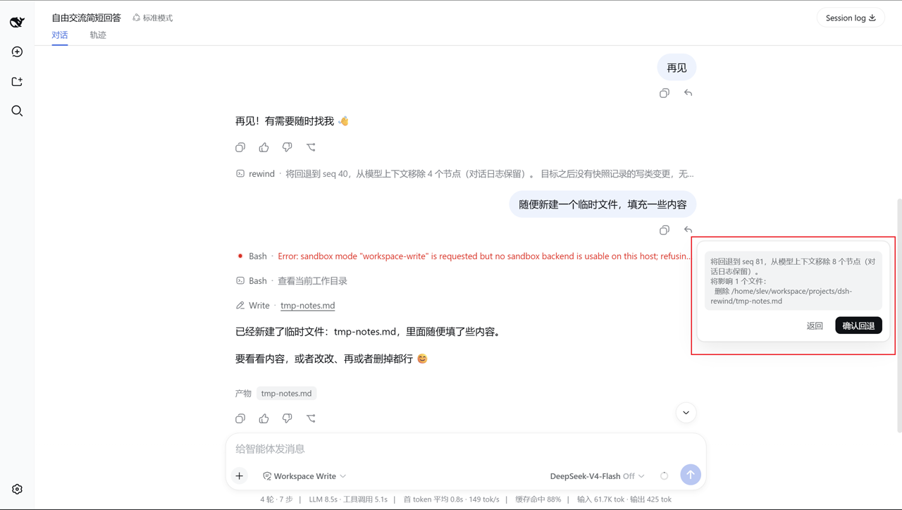
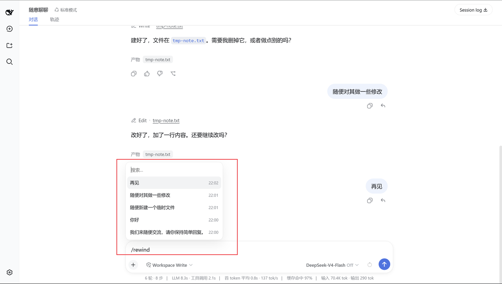
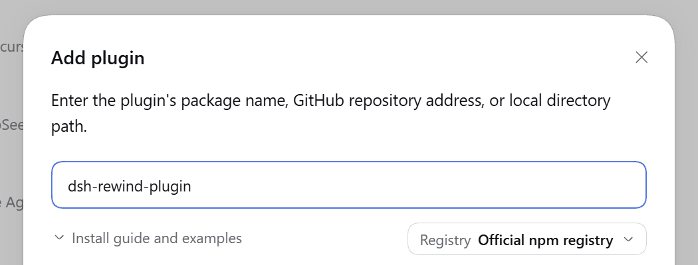

# dsh-rewind

DeepSeek Harness 插件：**就地回退对话到任意更早的用户消息**。<br />同窗口内完成，不新建分支、不换窗口，可一并还原工作区文件——即 Claude Code 风格的 `/rewind` 语义。

[English](README.md) | 中文

[](https://www.npmjs.com/package/dsh-rewind-plugin)
[](https://www.npmjs.com/package/dsh-rewind-plugin)
[](https://github.com/SiriLee/dsh-rewind/actions/workflows/ci.yml)


刻意聚焦、保持极简，只做一件事：**就地回退到任意远的用户消息**，还能**顺手还原改过的文件**。

- **就地消息回退**——目标消息及其之后的内容同时从**模型上下文**和**渲染对话**中撤回，目标消息文本自动回填输入框。始终在原会话内完成，不新建分支、不残留副本。
- **对话与文件一起回退**——对齐 Claude Code 的行为：在工作过程中自动追踪 DSH 的文件编辑，让你能快速撤销改动，在偏离预期时回退到之前的状态。
- **安全保障**——会话日志仅追加回退标记，从不删改；文件备份与还原经安全加固；**完备测试**，随 DSH 升级长期维护。安全模型：[docs/security-model.md](docs/security-model.md)。

## 效果预览

每条用户消息的操作行都有一个 **↶ 回退** 按钮。点击后弹出模式选择浮层——「**仅回退对话**」或「**回退对话和文件**」，后者会先展示文件变更清单再确认。还可以通过 **`/rewind` 和 `/undo` 命令**便捷地选择和回退。

<table>
  <tr>
    <td align="center"><br><sub>用户消息旁的 ↶ 回退按钮</sub></td>
    <td align="center"><br><sub>模式选择浮层</sub></td>
  </tr>
  <tr>
    <td align="center"><br><sub>「回退对话和文件」影响清单</sub></td>
    <td align="center"><br><sub>/rewind 候选面板</sub></td>
  </tr>
</table>

## 安装

**命令行**：

```sh
dsh plugin --profile <name> add dsh-rewind-plugin
```

**图形界面**：**插件**页 → **添加插件** → 填入 `dsh-rewind-plugin` → 安装。

<br>

默认安装适配最新的 DSH 稳定版本。若你的 DSH 版本不同，请在 [Releases](https://github.com/SiriLee/dsh-rewind/releases) 页面找到匹配的插件版本。

> [!WARNING]
> npm 上的 `dsh-rewind` 属于其他作者，请用 `dsh-rewind-plugin` 安装。

## 使用

1. 在对话中找到要回退的那条用户消息，或输入 `/rewind`（或其别名 `/undo`）打开回退菜单。
2. **选中它。** 小浮层提供两种模式——「仅回退对话」或「回退对话和文件」。
3. 对话还原后，所选消息的原始提示词会回填到输入框，可重新发送或编辑。

**键盘操作**：候选列表与模式浮层均支持 ↑↓ 移动、Enter 确认、Esc 取消/返回。

<details>
<summary><b>边界说明</b></summary>

- **回退内容完整保存**——被撤回的内容仍在日志中，可在「轨迹」面板查看；也可禁用插件让它们重新显示（仅界面）。
- **回退无法原地撤销**——但可以先禁用插件让被撤回的内容重新显示，再在回退前的位置上点「在新对话中分支」，新会话的上下文即可包含这些内容。
- **插话也能回退**——模型尚未读取的 `steering` 插话消息，同样可作为回退目标，不会打断当前生成。
- **回退已读消息会打断当前正在运行的回合**——确保回退的安全执行。

</details>

## 快照管理

使用 dsh-rewind 时，在你每次发送一条会开启新一轮的提示词之前，检查点会自动捕获代码状态。这些检查点构成会话的**快照**，保存在 `<dsh home>/rewind-snapshots/`（默认 `~/.dsh/rewind-snapshots/`）。插件为每个会话保留最近 100 个检查点的文件快照；丢弃更早的检查点时，会删除不再被任何保留检查点引用的快照文件。

**快照备份**功能（默认开启）控制是否记录检查点。可在本插件的配置卡片中关闭。关闭后不再创建新的快照，关闭期间的文件改动无法还原；不需要文件还原的用户可以借此省去额外的副本与读写开销。

**快照自动清理**功能（默认关闭）启用后，会删除长期不活跃会话的快照目录——默认在会话闲置约 30 天后执行。可在本插件的配置卡片中配置和查看（自动清理开关与失活天数），详见[快照自动清理](docs/snapshot-auto-cleanup.zh.md)。


## 卸载

```sh
# 卸载插件
dsh plugin --profile <name> remove dsh-rewind-plugin

# 如需同时删除本地数据
rm -rf <dsh home>/rewind-snapshots
rm <dsh home>/snapshot-cleanup-last-sweep.json
```

本插件的配置项保存在当前 Profile 的配置文件 `cordis.patch.yml` 中。如需彻底清理，可手动删除对应条目。

## 本插件的作用

相较于默认行为，本插件带来的变化：

| 维度 | 默认行为 | 本插件 |
| --- | --- | --- |
| 对话回退 | 新建分支对话 | **就地回退**——不用新建会话分支、不切窗口，也不产生残留会话副本 |
| 文件还原 | 手动还原 / Git 管理 | **一键还原**——随对话一并快速撤销改动，贴合 Agent 工作流 |
| 还原依赖 | 常依赖 Git 仓库或完整快照引擎 | **无依赖**——任意目录均可使用 |

## 原理

整套设计只有两条主线，核心哲学朴素却克制：**对话部分「只遮蔽、不删除」**，使用 DSH 原生的「隐藏 + 替换」机制；**文件部分「局部追踪 + 检查点」**，参考 Claude Code 的检查点语义。

### 1. 对话回退：一次「遮蔽」，而不是「删除」

`append-only` 是铁律：会话日志只追加、从不改写——这是可审计与信息安全的地基。回退从不动历史，它只做一步：往日志末尾追加一条 **“空消息”标记**，把目标消息及其之后的全部内容「遮蔽 + 替换」掉，让模型和界面都只看得到目标之前的部分。

- **同一份日志**——只在当前会话的日志做简单追加，不新建会话、不新建分支，因此不会留下残留和副本；
- **标记是规范的**——采用与官方 `/compact` 相同的「隐藏 + 替换」：`/compact` 把一段历史压缩成摘要，`/rewind` 则换成一条“空消息”标记。由于其规范性，DSH 的日志重放、压缩、续接检查都能正确识别它，绝不会把它误认为真实对话；
- **替换内容无感**——模型对标记忽略、无感（实测验证）。配合插件对界面显示的处理，模型和你看到的对话就是目标消息当时的样子；
- **记录完整保留**——因为是「遮蔽」而非「删除」，被撤回的内容完整留在日志里，可审计、可追溯，原则上也能手动恢复。

> **设计要点**：整个对话回退就是**一条**追加。它确定、可审计，且因为日志从未被破坏，回溯是「干净的」——用最小的动作，实现最完整的语义。

### 2. 文件还原：局部追踪与轻量检查点

文件部分对齐 Claude Code 的检查点语义——**局部追踪 + 检查点**，而不是整树快照。这项取舍省空间，也让已跟踪文件的改动同样可还原：

- **局部追踪**：追踪 DSH 文件编辑工具（`write`、`edit`）带来的所有改动——记录首次触碰的文件，并备份其改动前的状态；从不备份整个工作区，因此轻量。
- **检查点**：每当你发送一条会开启新一轮的提示词，检查点都会在该提示词生效前自动捕获**已跟踪文件**的状态。已跟踪文件的外部变更（如执行命令、手动修改）也可以由之后的回退还原。
- **不变不存**：检查点记录时，未变化的文件不会被备份；沿用前一检查点的同一版本，而不是复制一份。
- **还原准确**：以备份为唯一标准，对照真实磁盘，只动真正不一致的文件；备份逐字节存储。还原结果与备份一致，无“幽灵影响”。覆盖范围按设计限定：[文件回退的追踪边界](docs/compat/tracking-boundary.zh.md)。
- **安全与完整性**：路径经安全化处理，绝不越出备份根目录；符号/硬链接跳过，避免透过一次还原误伤同名的另一份文件；单个文件失败绝不中止整轮还原；检查点与版本均原子写落盘（跨重启仍在），目标文件不会半写；崩溃后可重跑收敛。

> **设计要点**：**消息边界检查点 + 首次触碰捕获 + 版本复用**——消息边界的检查点会重读所有已跟踪文件并记录其状态；首次触碰把新文件及其触碰前状态纳入追踪；还原时只动真正不一致的文件。磁盘占用小，适合会话内的快速恢复。

## 范围与分工

本插件刻意保持轻量、聚焦「对话回退」这一件事，以下场景**不属于它的职责**，各自有更合适的归属（见[设计边界](docs/boundaries.zh.md)）：

- **整树快照**——检查点用于会话内的快速恢复，不替代版本控制。需要长期版本历史与协作时，继续使用 Git 等版本控制工具来提交、分支和管理长期历史。
- **子代理的编辑**——不追踪，子代理会话内也不提供回退：子代理运行在自己的会话里，其备份无法由父会话的回退还原，因此也不会为子会话保留备份。
- **fork / 分支回退**——DSH 已内置「在新对话中分支」功能，不重复造轮子。

## 兼容性

- Node.js `>=24.9.0`。
- 支持的 DSH 版本由 `package.json` 的 `engines.dsh` 声明。
- 兼容性定义、验证方法与版本对齐详见 [docs/compat/audit.md](docs/compat/audit.md)。

> [!WARNING]
> 本项目与 DeepSeek Harness 均处于开发者预览阶段。可复现环境请 pin 精确版本，并阅读上述行为说明。

## 已知限制

1. **轮次导航保留已回退轮次**——右侧轮次导航为已回退轮次保留「未加载」刻度，悬浮可预览已撤回内容。仅显示差异，无功能影响。
2. **较远回退可能显示空白**——回退目标早于已加载的历史时，对话区会显示空白；需点击「加载更早」往前翻，才能看到历史对话。

> [!NOTE]
> 本插件提供浏览器端诊断输出；详见 [浏览器诊断](docs/compat/diagnostics.zh.md)。

## 安全

本插件只向会话日志追加回退标记事件，从不删除或改写已记录的历史。工作区文件仅在「回退对话和文件」时被改写，备份存储于 `<dsh home>/rewind-snapshots/`；还原以备份为唯一来源。不触碰你的 git 仓库，无网络请求，不访问任何凭据。对**长期不活跃**的会话，另有默认关闭的快照自动清理可整目录移除其快照，不影响活动会话与对话日志。完整安全模型：[docs/security-model.md](docs/security-model.md)；漏洞报告政策见 [SECURITY.md](SECURITY.md)。

## 开发

```sh
npm install            # devDeps 来自 npm registry
npm run check          # 一键全检：typecheck + test + build + verify:host + pack --dry-run
npm run typecheck      # tsc 三面编译（host + client + client-test）
npm test               # vitest：全部单元与兼容性测试套件
npm run build          # esbuild：lib/index.js（host ESM）+ lib/client.js（loader 闭包）+ .d.ts
node scripts/verify-host.mjs   # 端到端验证构建产物
```

`prepack` 在打包前执行完整构建，所以 `npm pack` / `npm publish` 总会产出完整的 `lib/`。请从 npm 或打好的 tarball 安装——git 检出的源码里没有构建好的 `lib/`。

维护者：源码布局与架构见 [docs/architecture.md](docs/architecture.md)，harness 接口参考见 [docs/harness-reference.md](docs/harness-reference.md)。

贡献指南：[CONTRIBUTING.md](CONTRIBUTING.md)

## 发布

通过 GitHub Actions Trusted Publishing（OIDC，无存储 `NPM_TOKEN`）发布：推送 `v<版本>` tag，CI 即带 Sigstore provenance 发布。

```sh
npm version patch && git push origin <branch> --tags
```

一次性 npm 侧配置与完整流程：见 [docs/release/release.md](docs/release/release.md)。

## 许可

[MIT](LICENSE)
